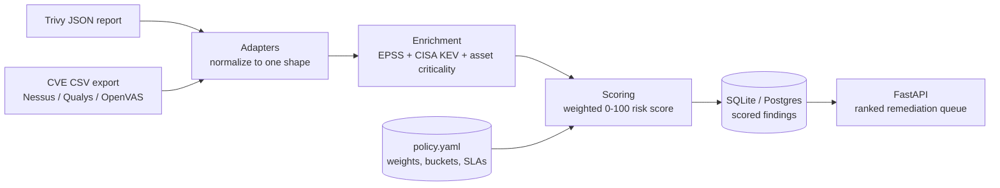

# vuln-priority-engine

**Patch what attackers will actually use first, not just what scores highest on CVSS.**

## The real problem

Vulnerability scanners hand security teams thousands of findings, and most
of them get sorted by CVSS. CVSS measures how bad a flaw is in theory, not
how likely it is to be exploited. The result is a backlog full of "High"
CVEs that nobody will ever attack, with the handful that are being
exploited right now buried somewhere in the middle.

`vuln-priority-engine` fixes the ordering. It takes raw scanner output,
enriches every finding with real-world exploitation signals and business
context, and fuses them into one tunable 0-100 risk score. Each finding
lands in a priority bucket with a remediation SLA, so the queue reads top
to bottom in the order the work should be done.

## Architecture



| Stage | Module | What it does |
|---|---|---|
| Ingest | `app/adapters/` | Parses Trivy JSON and generic CVE CSV exports into one `NormalizedFinding` model |
| Enrich | `app/enrichment.py` | Merges EPSS exploit probability, CISA KEV status and asset criticality onto each finding |
| Score | `app/scoring.py` | Combines the four signals into a 0-100 risk score and maps it to a priority bucket and SLA |
| Policy | `app/policy.py`, `policy.yaml` | Holds weights, bucket thresholds and SLA days, so prioritization is retuned without a code change |
| Store | `app/db.py` | Upserts scored findings through SQLAlchemy (SQLite by default, Postgres via `DATABASE_URL`) |
| Serve | `app/main.py` | FastAPI endpoints for ingesting reports and querying the ranked queue |

## Quick start

Requires Python 3.11+.

```bash
git clone https://github.com/SAARTH4555/vuln-priority-engine
cd vuln-priority-engine
python -m venv .venv && source .venv/bin/activate
pip install -r requirements.txt

# run the test suite (offline, no network or API keys)
pytest

# start the API
uvicorn app.main:app --reload
```

Then, in another terminal:

```bash
# load the bundled Trivy + CSV sample reports
curl -X POST http://localhost:8000/ingest/sample

# read the ranked remediation queue
curl "http://localhost:8000/vulns?limit=10"
```

Interactive API docs are at http://localhost:8000/docs.

### Docker

```bash
docker build -t vuln-priority-engine .
docker run -p 8000:8000 vuln-priority-engine
```

## How it works

**1. Normalize.** Every scanner format is parsed into the same
`NormalizedFinding` model (`app/models.py`), so enrichment and scoring
never deal with vendor formats.

- `trivy_adapter.py` reads Trivy's JSON report schema
  (`trivy image -f json ...`). When a report carries several vendor CVSS
  scores it prefers NVD, then Red Hat, then GHSA, and skips `Results`
  entries that have no vulnerabilities (secret or misconfiguration scans).
- `csv_adapter.py` reads generic CVE CSV exports and accepts common header
  synonyms (`host`/`hostname`/`ip` for `asset_id`, `cve`/`vulnerability_id`
  for `cve_id`, and so on). Rows without a valid CVE identifier are skipped
  instead of failing the whole file.

Each finding gets a deterministic `finding_id` (asset + CVE + package), so
re-ingesting the same report updates rows instead of duplicating them.

**2. Enrich.** Three signals are merged onto every finding:

| Signal | Source | What it adds |
|---|---|---|
| EPSS | FIRST.org Exploit Prediction Scoring System | Probability (0-1) that the CVE is exploited in the next 30 days |
| KEV | CISA Known Exploited Vulnerabilities catalog | Whether the CVE is confirmed to be exploited in the wild |
| Asset criticality | `data/asset_criticality.yaml` | How much the affected asset matters to the business |

The pipeline runs against bundled sample feeds in `data/`, so it works
fully offline. `fetch_live_epss_scores()` and `fetch_live_kev_catalog()` in
`app/enrichment.py` download the current public feeds when you want live
data. Missing intel degrades gracefully: a CVE with no EPSS entry scores
0 on that signal, and an unlisted asset falls back to the default tier.

**3. Score.** Each signal is normalized to 0-100 and combined as a weighted
sum, with the weights read from `policy.yaml`:

```
risk_score = 0.35 * (CVSS / 10 * 100)
           + 0.35 * (EPSS * 100)
           + 0.20 * (100 if KEV-listed else 0)
           + 0.10 * asset_criticality_score   # critical 100, high 75, medium 50, low 25
```

The score maps to the first bucket whose threshold it meets. Any
KEV-listed CVE is escalated to `critical` regardless of score
(`force_critical_on_kev: true`). Ties are broken by EPSS, then CVSS, so the
finding more likely to be exploited soon is queued first. Every scored
finding carries a `score_breakdown` showing each weighted component.

| Bucket | Min score | SLA |
|---|---|---|
| critical | 80 | 7 days |
| high | 60 | 30 days |
| medium | 40 | 90 days |
| low | 0 | 180 days |

### Example: the bundled CSV sample

| CVE | Asset (tier) | CVSS | EPSS | KEV | Risk score | Bucket |
|---|---|---|---|---|---|---|
| CVE-2021-44228 (Log4Shell) | web-prod-03 (high) | 10.0 | 0.974 | yes | 96.59 | critical, 7 days |
| CVE-2019-0708 (BlueKeep) | db-prod-01 (critical) | 9.8 | 0.921 | yes | 96.54 | critical, 7 days |
| CVE-2023-38831 (WinRAR) | web-prod-03 (high) | 7.8 | 0.451 | no | 50.59 | medium, 90 days |
| CVE-2020-1234 | internal-tool-07 (low) | 5.5 | 0.005 | no | 21.93 | low, 180 days |

## API

| Method | Path | Description |
|---|---|---|
| GET | `/health` | Liveness probe |
| GET | `/policy` | The loaded scoring policy |
| POST | `/ingest/sample` | Ingest the bundled Trivy and CSV samples |
| POST | `/ingest/trivy` | Upload and ingest a Trivy JSON report |
| POST | `/ingest/csv` | Upload and ingest a CVE CSV export |
| GET | `/vulns` | Ranked queue, filterable by `bucket`, `asset_id`, `min_score`, `limit` |
| POST | `/score` | Score one ad-hoc finding without storing it |

## Tuning the policy

Everything that decides "what counts as critical" lives in `policy.yaml`:
signal weights, asset-tier scores, the KEV override, and bucket thresholds
with their SLA days. Change the file and restart the service; no code
changes are needed.

## Project layout

```
app/
  adapters/          Trivy JSON and CVE CSV parsers
  enrichment.py      EPSS, KEV and asset-criticality merge
  scoring.py         risk-score formula and ranking
  policy.py          policy.yaml loader and validation
  models.py          NormalizedFinding -> EnrichedFinding -> ScoredFinding
  db.py              SQLAlchemy persistence
  main.py            FastAPI service
data/                bundled sample reports and threat-intel feeds
policy.yaml          scoring weights, buckets and SLAs
tests/               pytest suite
```

## Testing

```bash
pytest
```

The suite has 68 tests across the adapters, enrichment, scoring, policy
validation and the API, and runs entirely against the bundled fixtures
with an in-memory database.

## Known limitations

- The bundled EPSS and KEV files are small samples. Refresh them with the
  live fetchers before using the scores for real decisions.
- Asset criticality is a static YAML map; it is not pulled from a CMDB.
- Two input formats are supported today (Trivy JSON and CVE CSV).

## License

MIT - see [LICENSE](LICENSE).

## Maintainer

Built by Saarth Shetty, GTM & Marketing Data Analyst.

- GitHub: https://github.com/SAARTH4555
- LinkedIn: https://www.linkedin.com/in/saarth-shetty/
- Portfolio: https://saarthshetty.com
